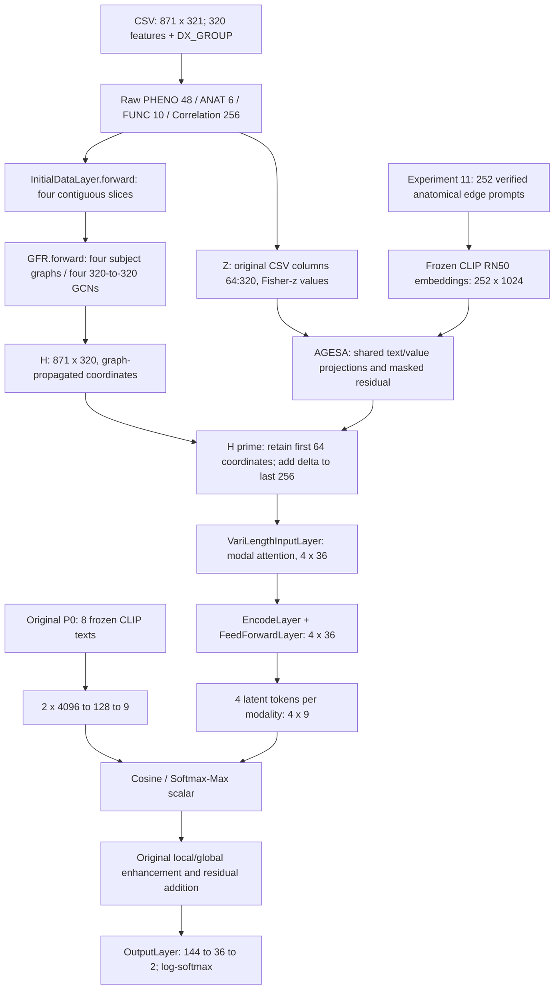

# 实验十二：源码与历史证据审计

本审计在创建 AGESA 模型前完成。审计依据是当前本地源码、实验一/八/九/十的 README、报告与接入补丁，以及实验十一的数值和解剖映射报告；不使用历史训练日志逐行推断。准确版本与文件 SHA256 由 `manifest.json` 保存。

## 实际数据流与接入位置

根代码对应：`main.py:111 train_and_eval`、`model.py:24 EvalHelper.__init__`、`model.py:81 run_epoch`、`layers.py:21 InitialDataLayer`、`network.py:197 GFR`、`layers.py:80 VariLengthInputLayer`、`layers.py:144 EncodeLayer`、`network.py:53 PLN`、`layers.py:175 OutputLayer`。实验接入在隔离 `model.py` 的 `EvalHelper.__init__` 完成原始 `ModalFusion.apply(my_weight_init)` 后注册新模块；在 `run_epoch(simple-2)` 的 `GFR -> ModalFusion` 两行之间插入 AGESA。评估由本实验运行器调用完全相同的 GFR/AGESA/PLN 前向，避免原 `_print_acc` 写根目录 attn/graph 文件。

## 输入与坐标含义

`modal_feat_dict.npy` 按 PHENO、ANAT、FUNC、Correlation 的插入顺序记录列名；CSV 前 320 列与四段列名逐项核对。PHENO 列 0:48 为年龄分桶、站点、性别；ANAT 列 48:54 为 `anat_cnr/efc/fber/fwhm/qi1/snr`；FUNC 列 54:64 为 `func_efc/fber/fwhm/dvars/outlier/quality/mean_fd/num_fd/perc_fd/gsr`；Correlation 列 64:320 是字符串列名 `0` 至 `255`。原 DX_GROUP 1=ASD、2=TD，减一后 0=ASD、1=TD；实际 403/468 人。

`InitialDataLayer` 依据长度直接连续切片，不依据 ROI 名称重排。`GraphLearn` 对每个模态做可学习线性映射，再计算所有受试者之间的余弦；阈值 .9 生成 detach 的 mask，保留阈值以上的加权余弦。四个图均是 871 个受试者节点。每个 GCN 使用全部拼接的 320 维特征，两个 GraphConv 都是 320->320；第一层后 ReLU。GFR 输出仍为 [871,320]，随后 PLN 按同样的 48/6/10/256 坐标区间分段，但坐标经过全特征线性混合和受试者传播，不能当作原始 Fisher-z，也不是 ROI 节点表示。

## 必须保留的源码行为

1. GFR 的 i=0 分支先构造 PHENO 图表示，但 i=1 用 ANAT 图表示加原拼接输入覆盖 `combined_feat`；i=2/3 再累加 FUNC/Correlation 图表示。i=0 图仍参与图正则。本实验保留这一行为，不修架构。
2. GFR 将仅训练索引的标签转为 +/-1，其他索引置 0，构造标签邻接先验；`ALoss` 是四图与先验的 Frobenius 距离均值。`run_epoch(simple-2)` 只优化加权 `ClsLoss` 与四模态 `GraphConstructLoss` 均值，**ALoss 被打印而未加入损失**。AGESA 不加新损失。
3. Pilot 的 GFR 仅传入内部训练真实标签，验证/测试位置传 -100；原 GFR 最终会把它们掩成 0。分类损失也只索引内部训练集合；图正则仍可使用全 871 人的特征，是原有 transductive 方式。
4. `VariLengthInputLayer` 用每模态 Q/K/V 线性层和跨模态注意力产生 [871,4,36]；EncodeLayer 与 FeedForward 保持形状。`PLN.forward` 硬编码 `view(871,4,4,9)`，本实验不修改它。四个 9 维 token 是可学习模态特征坐标组，无法与具体 ROI 一一对应。
5. P0 原八句含原拼写 `Nromal brain volume`，逐字保留。冻结 RN50 输出 [8,1024]，前四/后四句拼成 [2,4096]；共享原 MLP 为 4096->128->9，两层后均 ReLU。所有模态共享两个原型。余弦经 clamp、softmax、max 得 [871,4,4]，乘局部 token。全局平均池化 [871,4,36]->[871,4,9]；每个局部块使用 softmax(part*global) 做逐特征增强，拼回后加到原 x。最终 144 维拼接经 OutputLayer 得 [871,36] 隐藏表示及 [871,2] log-softmax。
6. 原两个 Adam 在 PLN `my_weight_init` 前注册；my_weight_init 仅覆盖 Linear 权重为 Xavier，不重新初始化 bias。新模块在这一过程之后建立，使用 fork_rng 隔离初始化；原 Adam 组不动，MF optimizer 增加 lr=.0038、weight_decay=0 的新组。P0 文本缓存在共同设训练种子之前加载，四组统一使用已缓存的原始 RN50 向量；parity 使用同样缓存和种子的原始 EvalHelper。
7. 原 main 把外层测试同时用作 val，按其 ACC 选 checkpoint，且 Hard-AUC 使用 hard prediction。本 pilot 按用户要求新增独立内部分层验证集；只用内部 val ACC 严格增大选 checkpoint，不以 BA/AUC 破坏平局。连续 Probability-AUC 用 `exp(output)[:,0]` 对 `label==0`。因此不能把本 pilot 与历史 30 折均值作直接性能比较。

另外，原 GFR 的 `combined_weight`/`c_w` 和 GraphLearn 的 `w/t/threshold` 在此 cosine 路径没有用于最终计算；被覆盖的第一路 GCN 不影响分类损失。这些原始参数仍注册于原优化器和总参数量中，本实验不要求原本不连通的参数突然获得分类梯度，也不顺手删除它们；分类头和 AGESA 的实际梯度另行核验。

## 历史证据和研究定位

| 实验 | 已核验的实际结果 | 对本次设计的约束 |
|---|---|---|
| 1 | P0 ACC/Hard-AUC 91.69/91.54%；P1 91.80/91.62%；普通文本错配/通用对照差异小 | 本次回到原 P0；模态 token 不具有 ROI 身份 |
| 8 | S1 91.73/91.51%，未超过 P1；疾病分支和主干概率相关约 .958，错配疾病及中性文本也可学习类别方向 | 关闭疾病投影、额外 CE 和决策融合 |
| 9 | P1 联合组 E7 相对 P1 ACC -0.114pp；模态判别接近机会水平但受试者配对 R@1 也近随机；疾病分支未减少预测冗余 | 关闭 GRL/判别器，不把可训练分支误判为语义收益 |
| 10 | ASD 对 ADHD/中性文本 ACC 差 +.192/+.077pp，seed 方向不一致；中性文本同样较 P3 改善 | 必须有 SHUFFLED、ID_ONLY 训练对照，不能把身份编码叫医学知识 |
| 11 | 256/256 数值索引唯一，最大误差约3.997e-15；110标准ROI+额外3455；252双端可信、4条涉及82号ROI | 以真实索引连接原始值与解剖身份；异常维保留数值、语义mask为False |

历史一至七及八至十不支持继续措辞改写、MLP小修或追分。当前 AGESA 的医学信息只是正确解剖连接身份，不添加 ASD 异常方向或临床功能陈述。固定全量预处理/RFE 数据用于 pilot，可有上游预处理或选择信息共享的限制；本次不重做特征选择，不能视为独立外部泛化。

## 固定实现决定

共享无偏置 Linear(1024,32) 与 Linear(3,32)，phi(z)=[z,abs(z),sign(z)]，两路 L2 normalize；s=点积，r=z*tanh(s)，delta=.1*tanh(alpha)*r；alpha 为共享零标量。有效252项 scatter回256维；其余4项精确为0。新增32,865参数，无额外分类器、temperature、正交/对比损失或超参数搜索。首步 alpha 有梯度、投影梯度为0是预期；两步核验投影连通性。初始原模型和增强模型必须在相同模式/RNG下满足1e-6 parity。
